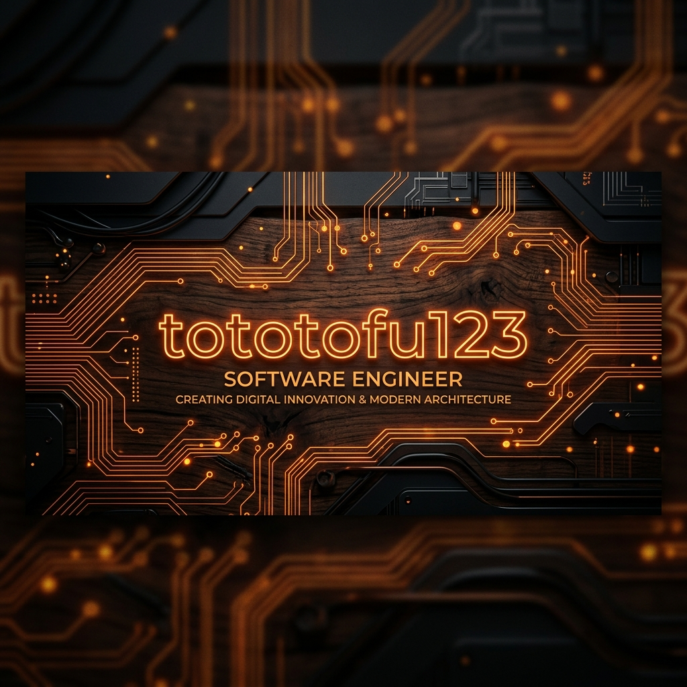

# tototofu123 | Engineering & Design

  

## The Hub
**Looking for the interactive showcase?**  
Visit my main portal: [**repo.lai.codes**](https://repo.lai.codes)

---

## Active Web Projects
This index is automatically synchronized with my latest GitHub activity.

<!-- REPO_LIST_START -->
- [Music Shuffler](https://tototofu123.github.io/music-shuffler) - Smart web-based music playlist shuffler for randomizing and discovering tracks via web interfaces.
- [CypherLabEncryption](https://tototofu123.github.io/CypherLabEncryption) - A demonstration and simulation of some major encryption methods with simulation and basic description of the method
- [Inclusive Tourism Decision Platform](https://tototofu123.github.io/inclusive-tourism-decision-platform) - Hackathon project for an inclusive tourism and accessibility decision intelligence platform for Kowloon and later all Hong Kong.
- [Hk Bus Fetch](https://tototofu123.github.io/hk-bus-fetch) - Real-time Hong Kong bus arrival (ETA) finder using KMB API and geolocation for smart route planning.
- [Openhere](https://tototofu123.github.io/openhere) - Apps open where you are — free single-file AutoHotkey v2 tray utility that moves every newly opened window to the monitor your mouse cursor is on (idea 032)
- [Perihel](https://tototofu123.github.io/perihel) - Perihel — local-first desktop companion. Hold Right Ctrl to dictate on-device, capture fleeting thoughts, resurface them at smart times. Rust + sherpa-onnx, no cloud. v2 unifies the app and dictation sidecar.
- [Agent Bus](https://tototofu123.github.io/agent-bus) - Local message bus for heterogeneous AI agents - rooms, presence, claims, handoff (idea 029)
- [Mini Projects](https://tototofu123.github.io/mini-projects) - Small self-contained experiments: games, visual toys, teaching tools and throwaway scripts. Merged from 13 standalone repos with full history preserved.
- [Hkust_climb_soc_web](https://tototofu123.github.io/hkust_climb_soc_web) - The HKUST Climbing Society Webpage
- [Ocr Mcp](https://tototofu123.github.io/ocr-mcp) - OCR Model Comparison Platform — benchmarks PaddleOCR, LightOnOCR, olmOCR, Chandra OCR, Dots MOCR, and Infinity Parser via llama.cpp
- [Mywebsite](https://tototofu123.github.io/mywebsite) - Personal portfolio website showcasing software engineering projects, AI experiments, and technical skills.
- [Stm32](https://tototofu123.github.io/stm32) - Embedded tank combat wargame on STM32F103VET6 featuring WiFi control, AI bots, and real-time HUD.
<!-- REPO_LIST_END -->